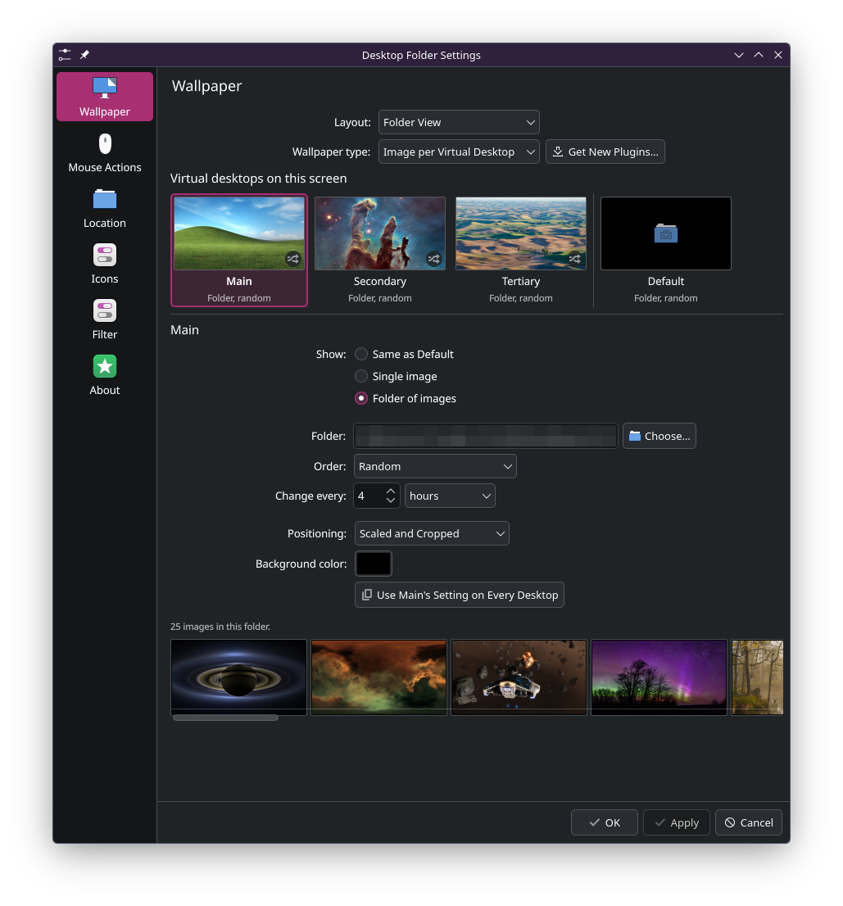
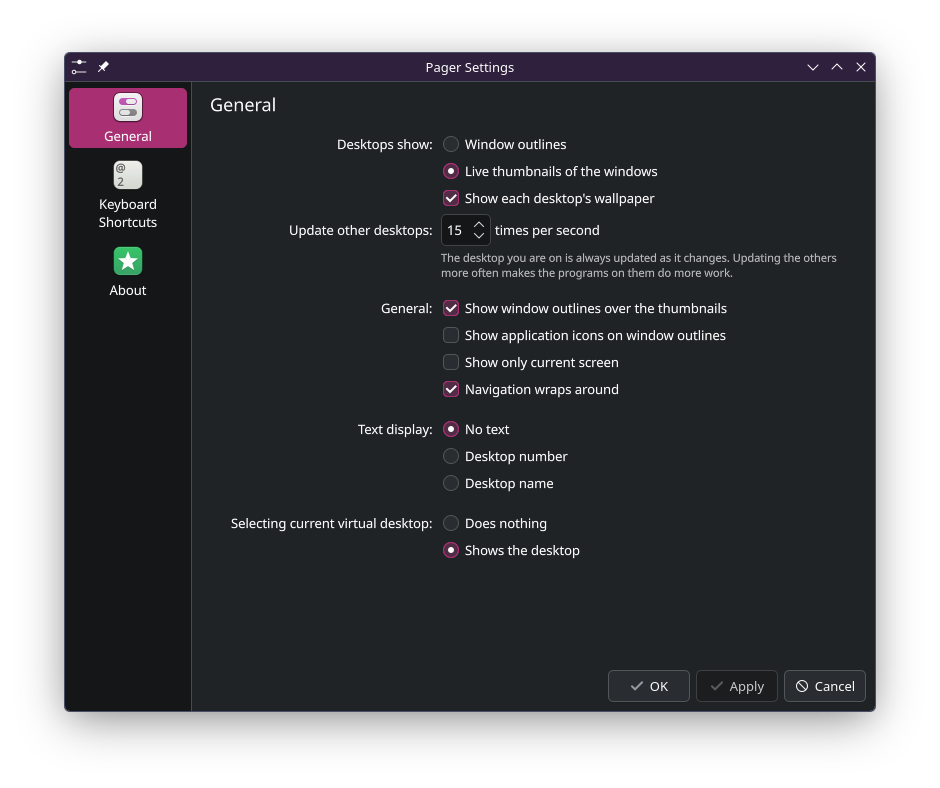

# Live desktop thumbnails and per-desktop wallpapers for KDE Plasma

The Pager is the Plasma panel widget that switches between virtual desktops. Stock Plasma
draws each desktop in it as window outlines. These patches make it draw a live,
scaled-down picture of each desktop.

A wallpaper plugin in this repository gives each virtual desktop its own wallpaper. It
installs on an unpatched Plasma.

The patches target KDE Plasma 6.7 on Wayland and touch four KDE repositories:
plasma-wayland-protocols, kwin, plasma-workspace and plasma-desktop.

- The Pager shows a live picture of each virtual desktop in its tile.
- Each virtual desktop has its own wallpaper, set per screen: a single image, or a folder
  of images with its own order and interval.
- The Pager tiles and KWin's Overview, desktop grid and desktop bar show each desktop with
  its own wallpaper.

   
  <em>The Pager in a panel, showing three virtual desktops.</em>

This is a prototype. It is not part of KDE and has not been submitted there. The patches
apply to Plasma 6.7.5.

## Contents

| Path | Holds |
| --- | --- |
| `src/desktop-wallpapers/` | The wallpaper type "Image per Virtual Desktop", in QML. Runs on an unpatched Plasma. |
| `patches/` | Commit series for plasma-wayland-protocols, kwin, plasma-workspace and plasma-desktop. |
| `session/`, `*.sh` | Scripts that build the patched pieces and run them from the home directory. See [docs/session.md](docs/session.md). |
| `tests/` | Nested-session tests and the scripts that measured the cost. |

## Wallpapers only

    src/desktop-wallpapers/install.sh

The script copies the plugin to `~/.local/share/plasma/wallpapers/`. Right-click the
desktop, open Desktop and Wallpaper, and set Wallpaper type to "Image per Virtual Desktop".

*Wallpaper settings: Desktop and Wallpaper, with the type "Image per Virtual Desktop".*

Plasma draws the desktop background as one window shared by all virtual desktops. On a
stock Plasma the Pager and the Overview therefore show the current desktop's wallpaper on
every desktop. The patches fix that.

## Patches

Each directory under `patches/` is a commit series. Apply it with `git am` to the matching
KDE repository at tag `v6.7.5`. For plasma-wayland-protocols the base is commit `e14966e`.
Build and install the protocol first; the other three find it through `CMAKE_PREFIX_PATH`.

| Series | Adds |
| --- | --- |
| plasma-wayland-protocols | `zkde_screencast_unstable_v1` version 7: `stream_window_scaled`, `stream_desktop`. |
| kwin | Scaled window streams and virtual-desktop streams in the screencast plugin. Per-desktop wallpapers in the Overview. |
| plasma-workspace | `libtaskmanager`: `ScreencastingRequest.desktopId`, `maxSize`, `excludeBackground`, `hiddenRefreshRate`. |
| plasma-desktop | The Pager: live thumbnails, per-desktop wallpaper in the tiles, settings. |

## How the thumbnails work

The Pager asks KWin for one PipeWire stream per virtual desktop with `stream_desktop`.
KWin caps a stream at 512 px on its long edge and paints that desktop's windows into it
in stacking order, including desktops that are not on screen.

- KWin repaints a stream when a window of that stream's desktop changes.
- Windows on hidden desktops draw once a second by default. The Pager has a setting for
  1 to 15 times a second.
- Panels, notifications, on-screen displays and applet popups stay out of the streams.
- KWin paints nothing while the screen is locked or off.
- The Pager pauses its streams while a fullscreen window is in use on its screen.

A Pager talking to an unpatched KWin draws window outlines.

*Pager settings: Configure Pager, General.*

## License

GPL-2.0-or-later. See [LICENSE](LICENSE).
